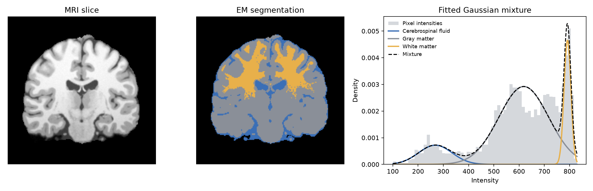
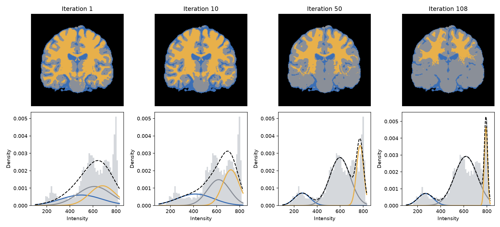

# EM Segmentation of Brain MRI

Tissue segmentation of a brain-MRI slice with a Gaussian mixture model fitted by
the Expectation-Maximization algorithm, implemented from scratch in NumPy.

Each brain pixel of a T1-weighted image is assigned to cerebrospinal fluid, gray
matter or white matter from its intensity alone. The project started during a
research internship on EM for latent-variable models (CNAM, 2025).



## Method

Pixel `i` has intensity `x_i` and a hidden tissue class `z_i ∈ {1..K}`, with
`p(z_i = k) = π_k` and `x_i | z_i = k ~ N(μ_k, σ_k²)`. The parameters
`θ = (π, μ, σ²)` maximise the log-likelihood `Σ_i log Σ_k π_k N(x_i; μ_k, σ_k²)`,
which has no closed-form maximiser because of the sum inside the logarithm.

EM works on a lower bound instead. By Jensen's inequality, for any distribution
`q_i` over the classes,

```
log p(x_i; θ)  ≥  Σ_k q_ik log( π_k N(x_i; μ_k, σ_k²) / q_ik )
```

with equality when `q_i` is the posterior `p(z_i | x_i; θ)`. The two steps are
coordinate ascent on this bound:

- **E-step** — make the bound tight at the current parameters:
  `q_ik = π_k N(x_i; μ_k, σ_k²) / Σ_j π_j N(x_i; μ_j, σ_j²)`
- **M-step** — maximise the bound over `θ`, in closed form, with `N_k = Σ_i q_ik`:
  `π_k = N_k / n`, `μ_k = Σ_i q_ik x_i / N_k`, `σ_k² = Σ_i q_ik (x_i − μ_k)² / N_k`

Since the bound touches the log-likelihood before the M-step and is increased by
it, the log-likelihood cannot decrease from one iteration to the next. The
implementation checks this property in its tests, computes responsibilities in
log-space for numerical stability, and floors the variances so that a component
cannot collapse onto a single pixel, where the likelihood is unbounded.

## Results

Middle coronal slice of a simulated BrainWeb T1 volume: 14,973 brain pixels after
masking, three classes, deterministic initialisation (equal weights, evenly
spaced means, common variance). EM converges in 108 iterations.

| Class | Weight | Mean intensity | Std | Pixels |
| :--- | ---: | ---: | ---: | ---: |
| Cerebrospinal fluid | 0.119 | 268.3 | 66.0 | 1,799 |
| Gray matter | 0.722 | 618.7 | 98.6 | 10,421 |
| White matter | 0.159 | 791.8 | 13.6 | 2,753 |

### The segmentation keeps moving after the fit looks finished



After 50 iterations the mixture already matches the histogram and the label map
looks anatomically sensible, but EM has not converged. Over the next 58
iterations the white-matter component keeps narrowing onto the sharp intensity
peak near 795 (standard deviation 31 → 14) and about a third of its pixels move
to the gray-matter class. The log-likelihood gain over that stretch is small
(−94,494 → −94,291) while the segmentation changes visibly.

Two things follow. A fixed iteration budget is not a stopping rule: the first
version of this project stopped at 50 iterations and reported that intermediate
state. And the maximum-likelihood mixture is not the anatomical segmentation:
the likelihood rewards a narrow component on the white-matter peak and lets one
wide Gaussian absorb everything between 400 and 780, including white-matter
pixels dimmed by partial-volume effects.

### Three classes are an anatomical choice, not what the intensities ask for

| Classes | Log-likelihood | BIC | Component means |
| ---: | ---: | ---: | :--- |
| 1 | −97,569.5 | 195,158.3 | 604 |
| 2 | −95,892.3 | 191,832.6 | 266, 649 |
| 3 | −94,290.7 | 188,658.2 | 268, 619, 792 |
| 4 | −93,746.5 | 187,598.7 | 275, 579, 730, 795 |
| 5 | −93,680.0 | **187,494.6** | 236, 327, 580, 727, 795 |
| 6 | −93,679.0 | 187,521.5 | 236, 340, 546, 617, 729, 795 |

The histogram has a fourth mode around 730, between the gray-matter bulk and the
white-matter peak; a four-component fit isolates it, and BIC is lowest at five
components. With three classes forced, that mode has to be shared between two
Gaussians that fit it poorly. (The six-component run had not converged after
5,000 iterations.)

## Limitations

- **Intensity only.** Pixels are treated as independent; there is no spatial
  prior, so isolated mislabelled pixels are not smoothed. A Markov random field
  on the labels is the standard remedy.
- **Gaussian classes.** Partial-volume pixels at tissue boundaries make the
  class-conditional intensities non-Gaussian, which is what the extra mixture
  components pick up.
- **No quantitative evaluation.** BrainWeb provides a ground-truth tissue map;
  Dice scores against it have not been computed yet.
- **One slice, one initialisation.** EM finds a local optimum; other starts and
  the full volume have not been explored.

## Usage

```bash
pip install -e ".[dev]"
python -m pytest                    # EM recovers known mixtures, likelihood is monotone

# data: see data/README.md
python -m em_segmentation.segment --image data/brain.nii.gz --mask data/brain_mask.nii
```

The command writes the figures and `figures/parameters.json`. Options:
`--view {axial,coronal,sagittal}`, `--slice`, `--classes`, `--min-intensity`,
`--tol`, `--max-iter`.

```
src/em_segmentation/
  gmm.py        EM for a 1-D Gaussian mixture, log-likelihood, BIC
  mri.py        volume loading, slicing, label map
  plots.py      figures
  segment.py    command-line entry point
tests/          parameter recovery, monotone likelihood, masking
notebooks/      executed walkthrough of the experiment
figures/        outputs of the run reported above
```

## References

- Dempster, Laird and Rubin, *Maximum Likelihood from Incomplete Data via the EM Algorithm*, JRSS B, 1977.
- Neal and Hinton, *A View of the EM Algorithm that Justifies Incremental, Sparse, and Other Variants*, 1998.
- Cocosco et al., *BrainWeb: Online Interface to a 3D MRI Simulated Brain Database*, NeuroImage, 1997.
- Zhang, Brady and Smith, *Segmentation of Brain MR Images Through a Hidden Markov Random Field Model and the Expectation-Maximization Algorithm*, IEEE TMI, 2001.
